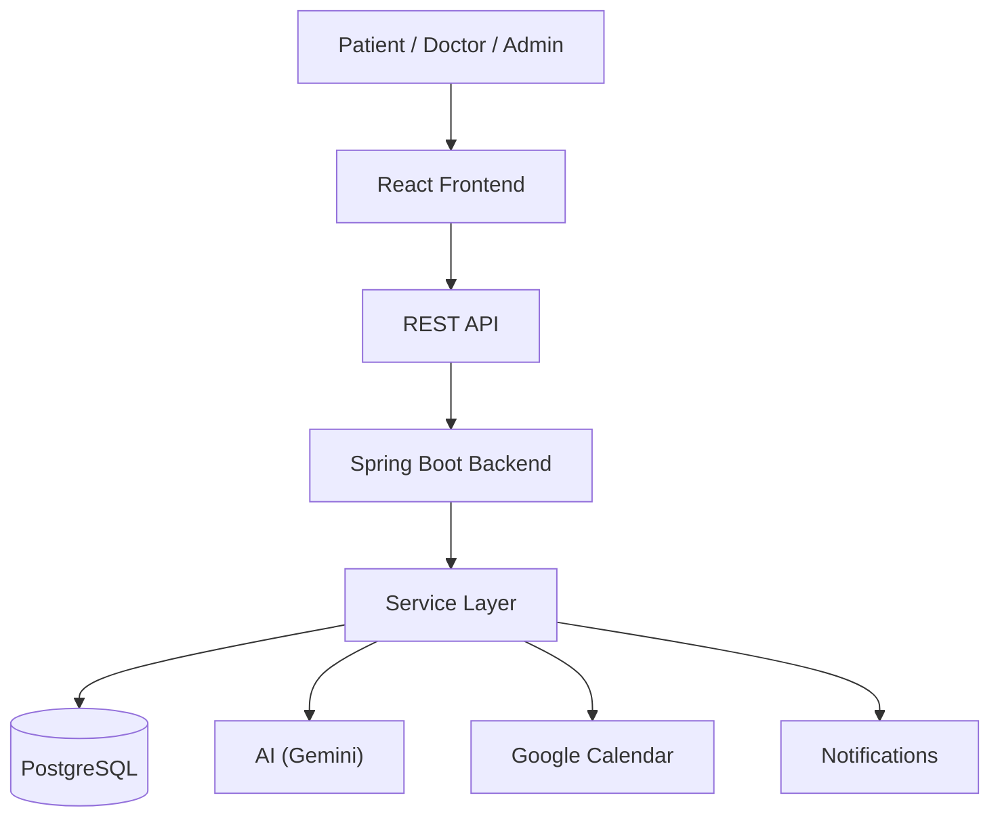

# Veyra — Healthcare Appointment & Follow-up Manager

A full-stack healthcare appointment platform that connects patients, doctors, and administrators through the complete appointment lifecycle — discovery, booking, consultation, prescriptions, and AI-assisted pre/post-visit summaries.

!!!CAN TAKE SOME TIME TO LOAD AS BACKEND IS ON RENDER AND ALSO IT BLOCKS SMTP PORTS!!!

## 🚀 Live Demo & Demo Accounts

> **Demo:** Run the application locally using the setup instructions below.

| Role | Email | Password | What to explore |
|------|-------|----------|-----------------|
| Patient | `patient@healthcare.dev` | `Patient@Dev1` | Book, view, reschedule and cancel appointments; view AI summaries |
| Doctor | `doctor@healthcare.dev` | `Doctor@Dev1` | View appointments, conduct consultation, add prescriptions, view/generate post-visit AI |
| Admin | `admin@healthcare.dev` | `Admin@Dev1` | Manage doctors, working hours, leaves and administrative controls |

> These are demo credentials intended for evaluating the application. Do not use them for production.

Demo accounts are seeded automatically on startup when `APP_SEED_ENABLED=true` (local development only).

---

## 🎯 Quick Recruiter Walkthrough

**Patient**

1. Login as patient.
2. Browse doctors.
3. Check doctor availability.
4. Select an available appointment slot.
5. Enter symptoms / reason for visit.
6. Confirm appointment.
7. Open appointment details.
8. View the pre-visit AI summary.
9. Try rescheduling.
10. Try cancellation.

**Doctor**

1. Login as doctor.
2. Open appointments.
3. Open the patient's appointment.
4. Complete the consultation.
5. Add clinical notes.
6. Add a prescription.
7. Generate/view the post-visit AI summary.

**Admin**

1. Login as admin.
2. Open doctor management.
3. View/manage doctors.
4. Configure working hours.
5. Manage doctor leaves / availability.

---

## Project Overview

Veyra is a healthcare appointment management platform connecting:

```
Patient → Doctor → Admin
```

It handles the complete appointment lifecycle:

```
Doctor discovery → Availability → Slot hold → Symptoms/reason → Booking
→ Pre-visit AI → Consultation → Prescription → Post-visit AI
→ Reschedule / Cancellation
```

---

## Key Features

### Patient

- Patient registration / login
- Browse doctors
- Doctor availability
- Appointment slot selection
- Temporary slot holding
- Appointment booking
- Symptoms / reason for visit
- Appointment history & details
- Rescheduling & cancellation
- Pre-visit & post-visit AI summaries
- Prescription / medication visibility
- Patient-specific access control

### Doctor

- Doctor authentication
- Appointment dashboard
- View assigned appointments
- Patient appointment details
- Consultation creation
- Clinical notes & follow-up instructions
- Prescription creation
- Post-visit AI summary

### Admin

- Admin authentication
- Doctor management
- Working hours
- Doctor leaves
- Availability management
- Role-based access control

### AI (Assistive Summarization)

- **Pre-visit AI** — converts the patient's symptoms / reason for visit into a structured preparation summary, including chief complaint, urgency, and suggested questions.
- **Post-visit AI** — uses the completed consultation to generate a patient-facing follow-up summary, including relevant medication information and follow-up steps.

> AI is an assistive summarization feature and is not intended to replace clinical judgment or provide autonomous medical diagnosis.

---

## Appointment Safety & Slot Management

1. Patient selects a doctor and slot.
2. The slot can be temporarily held.
3. The backend validates availability.
4. Conflicting active holds/appointments are rejected.
5. Booking confirmation converts a valid hold into an appointment.
6. Expired holds are handled.
7. Rescheduling re-validates availability.
8. Cancellation releases the slot.

The backend uses PostgreSQL partial unique indexes and transactional validation to prevent double-booking and concurrent slot conflicts.

---

## Security / RBAC

- JWT-based authentication
- Role-based authorization (PATIENT / DOCTOR / ADMIN)
- Ownership checks for appointments, holds, and consultations
- Protected doctor/admin endpoints
- Passwords hashed (BCrypt)
- Secrets loaded via environment variables only
- Unauthorized users cannot access protected resources

---

## Notifications

The application contains a notification architecture for events such as:

- Booking confirmation
- Rescheduling
- Cancellation
- Medication reminders
- Doctor-leave notifications

Lifecycle: `PENDING → PROCESSING → SENT / FAILED` with retry/backoff.

> **Note:** Production email delivery is currently not a verified live feature in the deployed environment. The notification architecture is fully implemented, but live email transport depends on the deployment's outbound email configuration.

---

## Technology Stack

| Layer | Technology |
|-------|------------|
| Frontend | React 18, Vite, React Router, Axios, Tailwind CSS |
| Backend | Java 21, Spring Boot 3.2, Spring Security, Spring Data JPA |
| Database | PostgreSQL (Flyway migrations) |
| Authentication | JWT, BCrypt |
| AI | Gemini (OpenAI-compatible endpoint) |
| Calendar | Google Calendar API (OAuth 2.0) |
| Notifications | Background worker + `EmailService` abstraction |
| Testing | JUnit / Spring Boot Test |
| Build / Deploy | Maven (backend), npm / Vite (frontend); Render (backend), Vercel (frontend), Supabase (PostgreSQL) |

---

## Architecture



---

## Project Structure

```
healthcare-appointment-manager/
├── backend/          # Spring Boot (Java 21, Maven)
├── frontend/         # React + Vite
├── docs/             # Engineering documentation
└── README.md
```

- `backend/` — Spring Boot application: controllers, services, JPA entities, Flyway migrations, Spring Security, AI / email / calendar integrations, background schedulers.
- `frontend/` — React SPA: role-based portals (patient / doctor / admin), auth context, API client, Tailwind design system.
- `docs/` — detailed engineering documentation (architecture, database, API, booking concurrency, notifications, Google Calendar, LLM / AI).

---

## Local Setup

### Backend

- Java 21+, Maven 3.9+
- Start PostgreSQL
- Configure `backend/.env` (copy from `backend/.env.example`)

```bash
cd backend
cp .env.example .env   # fill in your values
./mvnw spring-boot:run # or mvnw.cmd on Windows
```

API runs on **http://localhost:8080**.

### Frontend

```bash
cd frontend
npm install
npm run dev
```

UI runs on **http://localhost:5173**.

### Environment Variables

See `backend/.env.example` and `frontend/.env.example` for the full list. Placeholders only:

```
DATABASE_URL=...
JWT_SECRET=...
OPENAI_API_KEY=...
GOOGLE_CLIENT_ID=...
GOOGLE_CLIENT_SECRET=...
MAIL_USERNAME=...
MAIL_PASSWORD=...
```

`.env` files are gitignored and must never be committed.

---

## Database / Seed Data

The backend uses Flyway migrations (V1–V6) to create the schema. In local development, setting `APP_SEED_ENABLED=true` seeds the demo accounts:

| Role | Email | Password |
|------|-------|----------|
| Patient | `patient@healthcare.dev` | `Patient@Dev1` |
| Doctor | `doctor@healthcare.dev` | `Doctor@Dev1` |
| Admin | `admin@healthcare.dev` | `Admin@Dev1` |

---

## Testing

The backend test suite has **137 passing tests**, covering authentication, availability, doctor management, appointment booking, slot concurrency, AI summaries, notifications, Google Calendar, and application context. Tests use an in-memory H2 database and fake clients for external integrations (AI / email / calendar).

```bash
cd backend
./mvnw test
```

---

## Documentation

| Doc | Content |
|-----|---------|
| `docs/architecture.md` | Layers, modules, AI, structure |
| `docs/database.md` | Tables, migrations, indexes, time zone |
| `docs/api.md` | All endpoints, auth, errors |
| `docs/booking-concurrency.md` | Holds, unique indexes, transactions |
| `docs/system-design.md` | Design summary |
| `docs/notifications.md` | Lifecycle, email abstraction, scheduler, retries |
| `docs/google-calendar.md` | OAuth flow, sync lifecycle, retries |
| `docs/llm.md` | AI architecture, prompts, failure handling |

---

## Known Limitations

- **Production email delivery** is currently not presented as a verified feature (the notification architecture exists; live delivery depends on the deployment's email configuration).
- **Google Calendar** live OAuth depends on valid production credentials/configuration.
- **AI** requires a configured AI provider/API key.
- **Demo credentials** are for evaluation only.

---

For academic/demonstration use only.
